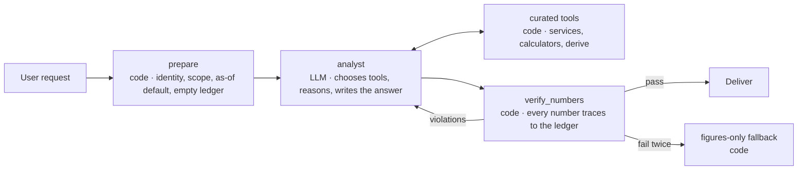

# Agentic Application Architecture Guide — ADK 2.0 (Python)

| | |
|---|---|
| **Version** | 2.0 (draft) |
| **Date** | 2026-09-10 |
| **Supersedes** | 0.1 |
| **Applies to** | Python 3.11+, `google-adk` 2.x, Pydantic v2, `uv` |
| **ADK APIs verified against** | adk.dev documentation, 2026-09-10; `google-adk` 2.8.0 for the items marked below (S-001, 2026-09-11); re-verified on `google-adk` 2.11.0 for §8.3–8.5 (2026-10-02) |

> This guide is split by section under `references/`; the rule summary and file index are in [../SKILL.md](../SKILL.md). Section numbers are the guide's own, so `§n` pointers elsewhere still apply.

---

## 0. What changed from 0.1 and why

Version 0.1 put the LLM inside a fixed graph with no tools. That guaranteed no model-made number could reach a user, but it also removed the reason to use an LLM: with the graph deciding what to fetch and compute, the model was left parsing a request and writing prose, which a form and a template can do.

Version 2.0 keeps the guarantee and restores the value:

| | 0.1 | 2.0 |
|---|---|---|
| Who decides what data to look at | The graph | **The agent**, choosing among curated tools |
| Who decides how to present it | A fixed output schema | **The agent**, within its instructions |
| How numbers are kept honest | Output schema with no numeric fields; `{{figure_id}}` placeholders | **Number verification after the answer**: every number in the reply must trace to a tool result or the user's input |
| Where determinism is enforced | The whole graph | **A thin shell** around the agent: identity in, verification out |
| Fixed graphs | The default | Reserved for processes that must be fixed (regulated reports, approvals, batch) |

The rule "the LLM never calculates" is unchanged. What changed is that we constrain the **output**, not the **control flow**.

---

## 1. How to use this document

This guide defines how agentic applications on Google ADK 2.0 are structured. It is written for engineers and for AI coding assistants (GitHub Copilot, Claude Code). Examples use an illustrative *portfolio limit review* domain; replace it with your own.

Rules carry IDs (`P3`, `CORE-6`, `VER-2`). Cite them in pull requests and reviews. Breaking a rule requires an ADR in `docs/adr/` **before** implementation.

Code is illustrative. Lines marked `# VERIFY` use ADK APIs that have changed between releases; check them against the pinned `google-adk` version. ADK releases roughly bi-weekly and 2.0 changed the agent API, event model, and session schema. Never rely on remembered API shapes.

### 1.1 Rules for AI coding assistants

1. Before writing code, state which layer(s) the change touches (§4) and follow that layer's rules.
2. Never add arithmetic, comparisons, aggregation, or rounding outside `core/calc/` (or certified SQL, `DATA-6`).
3. Never import `google`, `mcp`, or `fastapi` anywhere under `core/`.
4. Money, quantities, and rates are `Decimal`, never `float`.
5. SQL lives in `.sql` files, uses named parameters, and is never assembled from user or model input.
6. Every tool that returns numbers returns them as **figures** (`TOOL-3`) and records them in the turn ledger (`TOOL-5`). Never return raw rows.
7. Every user-facing answer that contains numbers passes number verification (§9) before delivery. Do not bypass the shell.
8. If a request conflicts with this guide, stop and explain the conflict instead of implementing it.
9. Verify ADK API usage against the pinned version's docs, not memory.
10. Do not override `_run_async_impl()`, append session events directly, or catch broad exceptions in nodes and tools. These 1.x patterns break ADK 2.0 retries and human-in-the-loop pauses.

---

## 2. Principles

**P1 — The LLM decides and explains; it never calculates.** Every number, comparison, delta, ratio, ranking, threshold check, and aggregation shown to a user is produced by deterministic code. The LLM chooses what to investigate, interprets results, prioritises, explains, and proposes actions.

**P2 — Constrain the output, not the control flow.** The agent is free to choose tools and shape its answer. The guarantee lives at the exit: a deterministic verifier checks that every number in the answer traces to a tool result or the user's own input (§9). Prompts saying "do not calculate" are necessary but not sufficient.

**P3 — Precompute what the agent may need to compare.** Tools return not just values but the comparisons a competent analyst would make next: breach flags, deltas versus prior period, ratios, rankings, headroom. If a number could plausibly be derived from two others, provide it, or provide a `derive` tool (§8.4) so the agent asks code to do it.

**P4 — Framework-free core.** Domain models, calculators, and services have no dependency on ADK, Google Cloud SDKs, MCP, or web frameworks.

**P5 — Typed contracts at every boundary.** Pydantic models for storage rows, domain objects, calculation results, tool results, and API payloads.

**P6 — Data access through repositories.** Business code depends on repository interfaces (`typing.Protocol`), never on SQL strings or clients.

**P7 — Code for what must not vary; the LLM for what benefits from judgement.** The test: *if you can write the decision tree, write code.* Identity, entitlements, calculations, formatting, and verification are code. Choosing which questions to ask of the data, connecting findings, weighing importance, and adapting to the reader are the LLM's job.

**P8 — Provenance on every figure.** Each computed result records which calculation and version produced it, for which as-of date, from which inputs.

**P9 — Identity and entitlements never come from the model.** They are established by the application layer and read by code, outside the model's control.

**P10 — Stable, verified APIs.** Prefer GA ADK features, pin versions, re-verify on every upgrade.

---

## 3. Interaction patterns

### 3.1 Pattern A — Analyst agent in a deterministic shell (default)

A workflow with three parts: a code node that prepares the run, an agent node with full tool freedom, and a code node that verifies the answer.



Use for: interactive analysis, "why" questions, follow-ups, anything where the question space is open. This is the default.

### 3.2 Pattern B — Fixed workflow

The 0.1 design: an explicit graph where code decides what to compute and the LLM is confined to intake and narration, with a strict placeholder output (§9.5).

Use for: regulated or repeatable reports, scheduled batch runs, processes with mandatory human approval steps, and anywhere an auditor must be able to read the control flow from the code. Do not use it for interactive analysis; it wastes the model.

### 3.3 Pattern C — Plain conversational agent

An `Agent` with tools and no shell. Use only for development, demos, and low-stakes lookups where no user decision depends on the numbers. Never in production for decision support.

### 3.4 Choosing

| Question | A | B | C |
|---|---|---|---|
| Is the question space open-ended? | **Yes** | No | Yes |
| Must the control flow itself be auditable? | No | **Yes** | No |
| Do users make decisions on the numbers? | Yes | Yes | **No** |
| Is human approval part of the process? | Optional | **Yes** | No |

---

## 4. Layers and the dependency rule

| Layer | Package | Responsibility | May import |
|---|---|---|---|
| Domain core | `core/` | Models, ports, calculators, services, guardrails, errors | stdlib, `pydantic` |
| Data | `data/` | Repository implementations, SQL files, row models | `core`, `google.cloud.*` |
| Tools | `tools/` | Function-tool adapters, the `derive` tool, the turn ledger | `core`, `google.adk` |
| Orchestration | `workflows/` | Shells, fixed graphs, prompts, LLM schemas | `core`, `tools`, `google.adk` |
| Agents | `agents/` | `root_agent` and `app` entry points | `workflows`, `tools`, `container` |
| API | `api/` | HTTP endpoints, authentication, session setup | `agents`, `container`, `fastapi` |
| Composition root | `container.py`, `config.py` | Settings and wiring | everything |

**Dependency rule:** imports point inward toward `core`. `data` implements `core.ports`. `tools` and `workflows` call `core.services` and never import `data`; the composition root injects concrete repositories. Enforced in CI (§13).

---

## 5. Project layout

Single `pyproject.toml`, `src` layout. Split into a `uv` workspace only when a second deployable appears (for example an MCP server, §8.6).

```
pyproject.toml
src/app/
├── core/
│   ├── models/            # domain models, figures (frozen, Decimal)
│   ├── ports.py           # repository Protocols
│   ├── calc/              # pure calculators, derive operations, rounding, formatting
│   ├── services/          # use cases: ports + calc → FigureSet
│   ├── guardrails/        # number verification, placeholder rendering (strict mode)
│   └── errors.py          # DomainError hierarchy
├── data/
│   ├── sql/<area>/*.sql   # one query per file
│   ├── rows.py            # row models mirroring storage
│   └── repositories/      # implementations of core.ports
├── tools/
│   ├── ledger.py          # turn ledger helpers (session state)
│   ├── derive.py          # the derive tool
│   └── <area>_tools.py    # thin adapters over services
├── workflows/
│   ├── shell/             # Pattern A: prepare → agent → verify
│   └── <name>/            # Pattern B fixed graphs
├── agents/<name>/
│   ├── agent.py           # exposes root_agent and app
│   └── prompts/*.md
├── api/
├── config.py
└── container.py
tests/
├── unit/  integration/  contract/  evals/  fakes/
```
